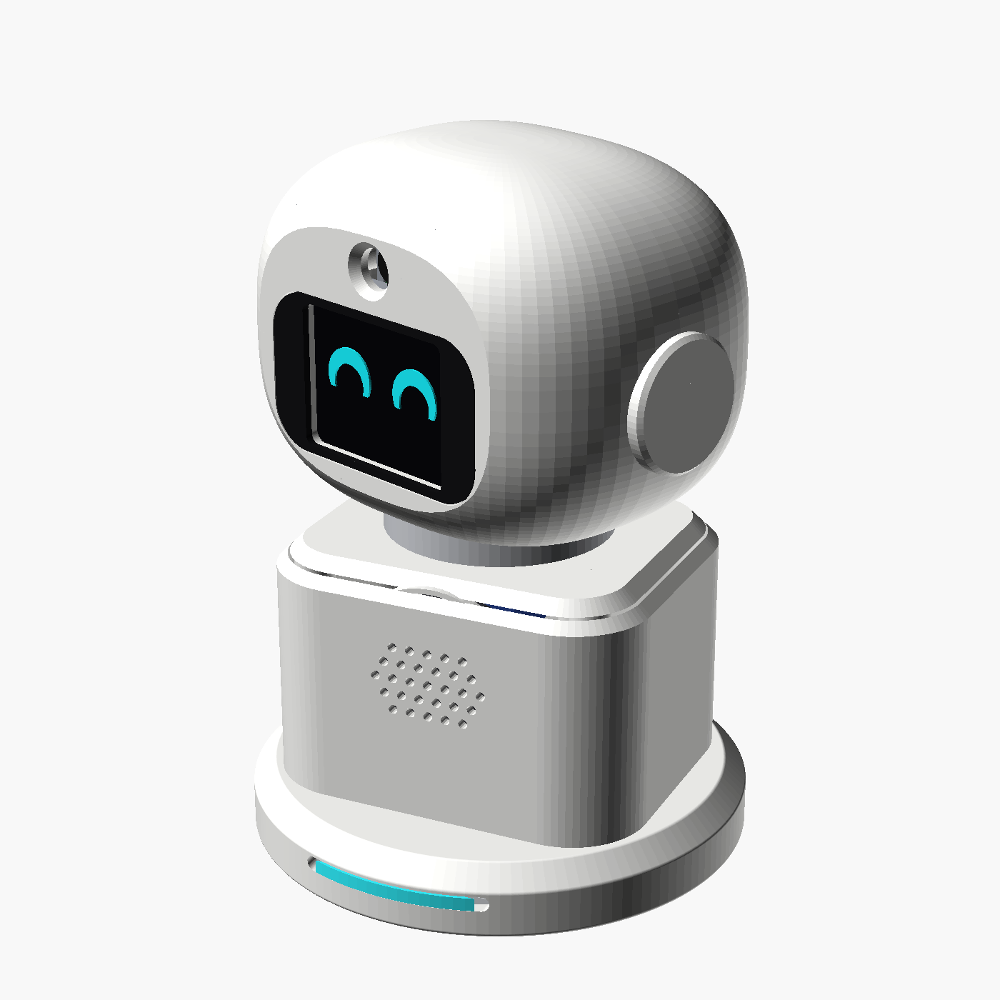
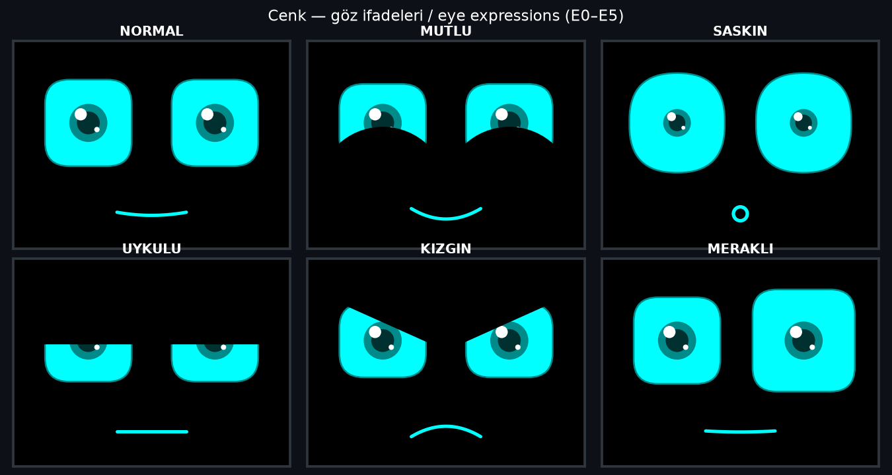
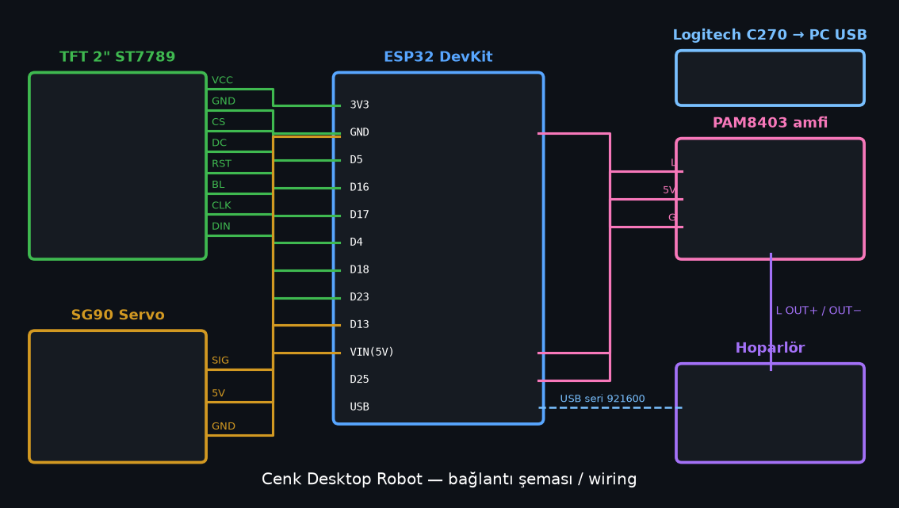
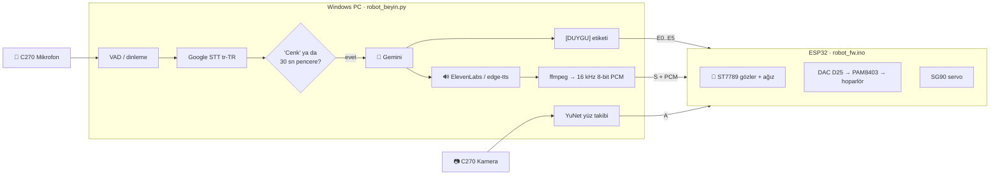
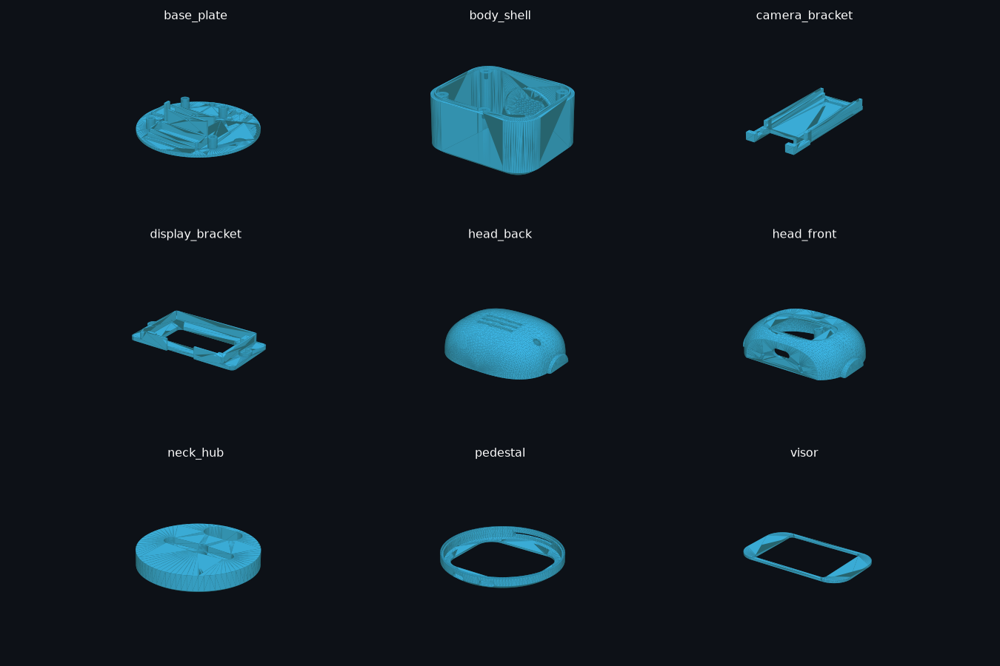
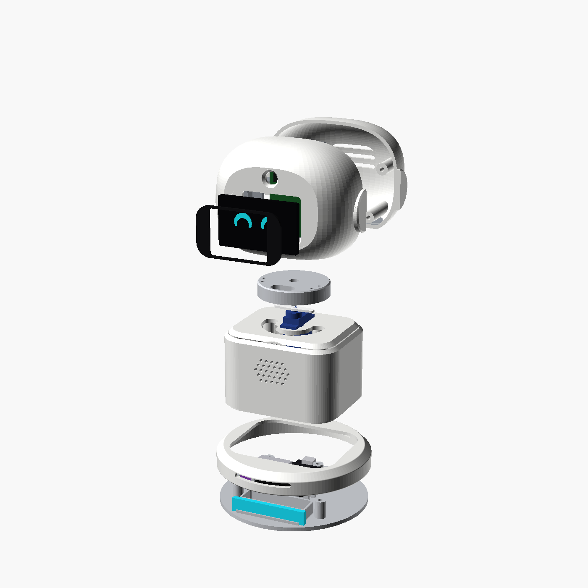

<div align="center">

# 🤖 Cenk — Yapay Zekâlı Masaüstü Robot

**ESP32 + Gemini + ElevenLabs ile konuşan, gözleriyle duygu gösteren, yüzünü takip eden 3D baskı masaüstü robot**




</div>

> 🇬🇧 **English summary:** *Cenk* is a 3D‑printed AI desktop robot. An ESP32 drives a 2" ST7789 display with animated eyes and a speaker; a Windows PC listens through a Logitech C270, wakes on the word **"Cenk"**, transcribes speech (Google STT), answers with **Gemini**, speaks with **ElevenLabs** (or free **edge‑tts**) and streams the audio to the robot over USB serial. YuNet face tracking is included. All STL files, firmware and PC code are here under MIT. Star ⭐ if you like it!

---

## ✨ Özellikler

- 👀 **Animasyonlu gözler** — 6 ifade: NORMAL, MUTLU, ŞAŞKIN, UYKULU, KIZGIN, MERAKLI; göz kırpma, etrafa bakınma, konuşurken oynayan ağız
- 🗣️ **Uyandırma kelimesi "Cenk"** — sadece adını duyunca cevap verir
- ⏱️ **30 saniyelik sohbet penceresi** — bir kez "Cenk" de, sonra adını tekrar söylemeden konuş
- 🧠 **Gemini LLM** — kota dolarsa otomatik olarak sıradaki Gemini modeline geçer
- 🔊 **Gerçekçi ses** — ElevenLabs (opsiyonel) ya da ücretsiz Microsoft edge‑tts; ses USB üzerinden robotun hoparlörüne akar
- 🎯 **Yüz takibi** — OpenCV **YuNet** ile yüzü bulur, servo ile kafayı çevirir
- 🎭 **Özelleştirilebilir karakter** — `pc/karakter.txt` dosyasını düzenle, yeniden başlatmadan anında uygulanır



## 🧩 Malzeme Listesi (BOM)

| Parça | Adet | Not |
|---|---|---|
| ESP32 DevKit (ESP32‑D, WROOM‑32) | 1 | USB seri 921600 baud |
| Waveshare 2" ST7789V IPS TFT (240×320) | 1 | SPI |
| SG90 servo (tercihen metal dişli MG90S) | 1 | kafa dönüşü |
| PAM8403 mini stereo amfi | 1 | 5V |
| 3W 4Ω / 8Ω hoparlör (~40 mm) | 1 | |
| Logitech C270 webcam | 1 | kamera + mikrofon, PC'ye USB |
| M3×10 vida | ~12 | |
| Jumper kablolar, USB kablo | — | |
| PLA/PETG filament | ~150 g | |

## 🔌 Bağlantılar



| Modül | Pin | ESP32 |
|---|---|---|
| TFT ST7789 | CS | D5 |
| | DC | D16 |
| | RST | D17 |
| | BL | D4 |
| | CLK (SCL) | D18 |
| | DIN (SDA/MOSI) | D23 |
| | VCC / GND | 3V3 / GND |
| SG90 servo | Sinyal | D13 |
| | VCC / GND | 5V (VIN) / GND |
| PAM8403 | L (sol giriş) | D25 (DAC1) |
| | G | GND |
| | 5V | VIN |
| Hoparlör | — | PAM8403 **L OUT+ / L OUT−** |
| Logitech C270 | USB | PC |

## 🏗️ Mimari



## 🚀 Kurulum

### 1) Firmware (ESP32)
1. **Arduino IDE** (ya da `arduino-cli`) kur, Boards Manager'dan **esp32 by Espressif** ekle.
2. Library Manager'dan: **Adafruit ST7735 and ST7789 Library**, **Adafruit GFX Library**, **ESP32Servo**.
3. `firmware/robot_fw/robot_fw.ino` dosyasını aç, kart: *ESP32 Dev Module*, yükle.

```bash
# arduino-cli ile
arduino-cli core install esp32:esp32
arduino-cli lib install "Adafruit ST7735 and ST7789 Library" "Adafruit GFX Library" ESP32Servo
arduino-cli compile --fqbn esp32:esp32:esp32 firmware/robot_fw
arduino-cli upload  --fqbn esp32:esp32:esp32 -p COM3 firmware/robot_fw
```
> `firmware/goz_animasyon` sadece ekran/göz testi için bağımsız bir örnektir.

### 2) PC programı (Windows)
1. **Python 3.10+** ve **ffmpeg** kur (`winget install ffmpeg`), ffmpeg PATH'te olsun.
2. Bağımlılıklar:
   ```bash
   cd pc
   pip install -r requirements.txt
   ```
3. API anahtarlarını ortam değişkeni olarak gir (bir kez, sonra yeni pencere aç):
   ```bat
   setx GEMINI_API_KEY "senin_gemini_anahtarin"
   setx ELEVENLABS_API_KEY "senin_elevenlabs_anahtarin"   &REM opsiyonel, yoksa edge-tts
   ```
   Gemini anahtarı: <https://aistudio.google.com/apikey> · ElevenLabs: <https://elevenlabs.io/app/settings/api-keys>
4. `pc/baslat.bat` dosyasına çift tıkla. 2 saniye sessiz kal (gürültü kalibrasyonu), sonra **"Cenk, naber?"** de.

Ayarlar: `--port COM3`, `--kamera 1`, `--mic "Mikrofon (Logi C270 HD WebCam)"`, `--yuztakip 1`, `--yon -1`, `--soyle "test"`. ElevenLabs sesini değiştirmek için `EL_SES` ortam değişkenine voice ID yaz.

### 🎭 Karakteri özelleştir
`pc/karakter.txt` sistem promptudur. Varsayılan karakter esprili, hafif argolu ama küfürsüz bir kanka. İstediğin kişiliği yaz; dosya her cevapta yeniden okunur.

## 📡 Seri Protokol (921600 baud)

| Komut | Anlamı |
|---|---|
| `A<açı>\n` | Servo açısı (30–150, orta 90) |
| `E<0-5>\n` | İfade: 0 NORMAL, 1 MUTLU, 2 ŞAŞKIN, 3 UYKULU, 4 KIZGIN, 5 MERAKLI |
| `V<0-120>\n` | Ses genliği |
| `S<uzunluk>\n` + ham veri | 16 kHz 8‑bit unsigned PCM akışı; ESP32 `AKIS_OK` ve bitince `SES_BITTI` yazar |
| `m` | Dahili "merhaba" sesini çal |
| `1` / `2` / `3` / `0` / `+` / `-` | Test: bip / melodi / tarama / sus / ses aç / ses kıs |

## 🖨️ 3D Baskı




Dosyalar: `3d-models/stl/*.stl`, tüm parçalar tek dosyada `3d-models/desk_robot_v1.3mf`, kaynak `desk_robot_v1.scad` (OpenSCAD).

| Ayar | Değer |
|---|---|
| Katman | 0.2 mm |
| Duvar / dolgu | 3 duvar, %15–20 gyroid |
| `head_front` | **Ağaç (tree) destek, sadece tablaya (build plate only)** |
| Diğer parçalar | Destek yok |
| Montaj | M3×10 vida |

## 🗺️ Yol Haritası
- [ ] **MAX98357A I2S amfi** — 16 bit temiz ses (8 bit DAC hışırtısı biter)
- [ ] **Metal dişli servo** (MG90S)
- [ ] **Yüz tanıma** — sahibini tanıyıp adıyla karşılama
- [ ] **Hafıza** — sohbetleri ve tercihleri hatırlama
- [ ] Hava durumu, saat, zamanlayıcı komutları

## 🤝 Katkı
PR ve issue'lar açık! Kendi Cenk'ini yaptıysan fotoğrafını issue olarak paylaş.

<div align="center">

### ⭐ Projeyi beğendiysen **star** ver ve yeni robotlar için **takip et!** ⭐

MIT License © 2026 Batuhan Civelek

</div>
